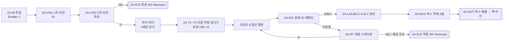

# 2A 공정 v2 검토 · 데이터 수집점 · dtwin-a-db 스키마 (초안)

11/23 모닝 미팅 결과 정리용 제안서. 확정 아님. 스크린샷(Factory I/O 상면도, 11/23)을 기준으로 읽었고 잘못 읽은 부분은 고쳐 주세요.
[2a-process.md](2a-process.md)(11/19)의 흐름을 대체한다 (3대 → 4레인 검사기, 재검 스테이션 부활, 비전 순서 변경).

## 0. 공정 v2 (미팅 기준)



스크린샷에서 읽은 배치:

- 좌상단 Emitter + 비전 2개 → 왼쪽 피더가 아래로 내려가며 검사기 4대(MC+로봇)에 옆으로 공급, 피더 끝(좌하단)이 Remover.
- 검사기 출구 4개 → 가운데 수집선 → 위로 올라가 오른쪽 분류선으로 넘어감 → 아래로 내려가며 A/B/C 롤러 레인 3개로 분기.
- 레인마다 Pick & Place 갠트리, 오른쪽 세로 롤러선 + 턴테이블 3개 = 박스 라인, 위쪽 끝으로 배출.
- 분류선 끝 → 우하단 재검 스테이션(5번째 MC+로봇) → 하단 긴 벨트로 돌아 수집선 아래로 재합류 → 다시 분류.

## 1. 배치 검토

결론: **큰 틀은 써도 된다.** 다만 아래 1~3번은 고치지 않으면 데모 중 셀이 사라지거나 무한 순환한다.

| # | 문제 | 영향 | 제안 |
|---|---|---|---|
| 1 | **최종 NG 출구가 없다.** 재검 스테이션 출구가 전부 수집선으로 돌아간다 | 재검에서도 NG인 셀이 분류선 → 재검 → 분류선을 무한 순환 | 재검 출구 직후(하단 복귀 벨트 시작부)에 푸셔 + 슈트 + Remover(2A-RJ2). 재검 1회 초과 또는 재검 NG면 배출 |
| 2 | **피더 끝 = Remover.** 외관 NG가 피더를 끝까지 타고 내려가 버려진다 | 검사기 4대가 모두 차 있으면 **양품도 피더 끝까지 가서 버려진다** (조용한 손실) | 외관 NG는 2차 비전 직후 짧은 푸셔·슈트로 바로 빼고, 피더 끝은 Stop Blade로 막아 양품을 대기시킨다. 유지할 거면 피더 끝 Remover 앞에 센서를 두고 "양품 유실" 이벤트로 기록 |
| 3 | **합류 후 순서가 깨진다.** 검사기 4대 병렬 + 재검 복귀가 한 수집선에 합류 | PLC FIFO만으로는 분류선의 셀이 누구인지 확신 못 함 → 등급 오분류 | 분류 푸셔 앞에 **ID 재확인 지점(2A-IDC)**. Factory I/O RFID Reader(부품 고유 ID 읽기)가 에디션에서 되는지 확인. 안 되면 출구 스퍼 해제 순간 PLC가 ID를 수집선 FIFO에 넣고, 2A-IDC 센서 통과 시 FIFO 맨 앞과 대조 |
| 4 | 합류 지점 간격 제어 | 수집선에서 셀끼리 붙어 센서가 1번만 켜짐 (prj01에서 확인) | 각 출구 스퍼 끝에 Stop Blade + 합류 구간 비점유 확인 후 해제. 재검 복귀선은 수집선 맨 아래로 들어오니 자연히 우선순위를 가짐 |
| 5 | 90° 옆 이송 | 셀이 틀어져 MC 베이에 안 맞음 (prj01) | 검사기 입구 스퍼에 Wheel Aligner 또는 가이드 |
| 6 | "버퍼형" 4레인 | MC 투입 → 시작 약 16초라 1개씩 보내면 로봇 대기 | 입구 스퍼마다 1셀 대기 자리(Stop Blade + 센서). 피더는 대기 자리가 빈 레인을 골라 보냄 |
| 7 | 박스 공급원 | 스크린샷에 빈 박스 Emitter가 안 보임 | 박스 라인 아래 끝에 박스 Emitter, 위 끝 Remover = C 인계 지점 |

선택 사항 (시간 남으면): 재검 루프가 하단 전체를 도는 구조라 WIP가 길다. 재검 스테이션을 분류선 끝 바로 옆에 두고 출구를 분류선 입구로 바로 넣으면 루프가 짧아지지만, 지금 배치도 동작상 문제는 없어서 우선순위 낮음.

## 2. 데이터 수집점

### 원칙

셀이 지날 때마다 다 적지 않는다. 아래 셋 중 하나에 해당하는 곳만 **이벤트**로 남긴다.

1. **값이 생기는 곳** (ID, 외관 결과, 전압·저항)
2. **판정·경로가 갈리는 곳** (외관 G/NG, 등급 분기, 재검 결과)
3. **소속이 바뀌는 곳** (박스 적재, C 인계, 폐기)

그 사이의 통과 센서는 셀 이력에는 안 남기고, 설비 상태·체류시간 계산에만 쓴다.

### 셀 이벤트 (최소 세트)

| 코드 | 위치 | 이벤트 | 남기는 값 |
|---|---|---|---|
| 2A-IN | Emitter 출구 | `CREATED` | run, 투입 순번, ts |
| 2A-VIS1 | 1차 비전 | `ID_READ` | cell ID, LOT, 성공/미판독 |
| 2A-VIS2 | 2차 비전 | `APPEARANCE` | G/NG, 결함 코드 |
| 2A-RJ1 | 외관 NG Remover | `SCRAPPED` | 사유 = 외관 |
| 2A-T1~T4 | 검사기 레인 1~4 | `TEST_START` / `TEST_END` | 레인, OCV·V1·I1·V2·I2, R, 등급, 결과, 사유, 시도 횟수(1) |
| 2A-IDC | 분류 ID 재확인 | `ID_CHECK` | 일치/불일치 (불일치면 알람) |
| 2A-LA/LB/LC | A/B/C 레인 입구 | `SORTED` | 목표 레인, 실제 진입 확인 |
| 2A-RT | 재검 스테이션 | `TEST_START` / `TEST_END` | 검사기와 같은 형식, 시도 횟수(2) |
| 2A-RJ2 | 최종 NG Remover | `SCRAPPED` | 사유 = 전압/저항/재검 초과 |
| 2A-BOX | 박스 적재 | `PACKED` | box ID, slot 1~4 |
| 2A-BOX | 박스 완료 | `BOX_CLOSED` | 등급, 셀 4개, 세트 편차(max−min) |
| 2A-OUT | 박스 배출 | `HANDOFF` | 요청 ID, box ID, C 수신 확인 |

셀 하나는 정상이면 9건 안팎, 재검 경로면 +3건. 100셀 시연이면 1~2천 행 수준이라 DB 부하는 문제 아님.

### 셀이 아닌 데이터

| 종류 | 수집 방식 | 용도 |
|---|---|---|
| 설비 상태 (검사기 4 + 재검 1 + 갠트리 3 + 피더/분류선) | 상태가 **바뀔 때만** 구간(시작·끝) 기록: idle / busy / blocked / starved / fault / stopped | 가동률, 병목 |
| 버퍼 재고 (검사기 대기 자리, A/B/C 레인, 박스 라인) | 1초 스냅샷 또는 증감 이벤트 | 라이브 트윈 화면, 대기시간 |
| 알람 | 발생·확인·해제 3시점 | 장애 이력 (11/30 장애 8건 시험 기록과 직결) |
| 기준값 변경 (D2200~) | 변경 시점, 이전·이후 값, 누가 | 분류가 언제 왜 바뀌었는지 설명 |
| LOT 보류 | 보류·해제 시점, 사유, 해제자 | 공급 차단 검증 |
| 통신 상태 | 하트비트 단절·복구 | 데이터 누락 구간 표시 |

### PLC → 수집기 전달 방식

100ms 폴링으로는 짧은 펄스를 놓치므로 **PLC 이벤트 메일박스(링 버퍼)** 를 둔다.

- 위치 제안: `D2700~D2799` (현재 셀 추적 대역 D2400~D2799의 끝. PoC는 D2627까지만 씀 → 협의 필요)
- 헤더 4워드: `D2700` 쓰기 순번(PLC), `D2701` 읽은 순번(브리지), `D2702` 넘침 횟수, `D2703` 예비
- 레코드 8개 × 12워드 (`D2704~D2799`): 순번, 이벤트 종류, 스테이션, 레인, 셀 ID(2워드), LOT, 결과, 사유, 값1~3
- 브리지는 `D2701 < D2700`이면 새 레코드를 읽고 `D2701`을 올린다. 버퍼가 차면 PLC는 넘침 횟수를 올리고 알람.
- **(run_id, 순번)** 이 곧 이벤트 ID → DB에서 중복 제거 (design-notes "이벤트 ID로 중복 제거"와 같은 규칙).
- 전압·저항 값은 브리지(값 생성기)가 만들어 PLC에 넣는 것이라 브리지가 이미 알고 있다. 레코드에는 셀 ID와 판정만 있으면 된다.

### dtwin이 답해야 할 질문 → 필요한 데이터

| 질문 | 필요한 데이터 |
|---|---|
| 지금 셀이 어디 있나 (라이브 트윈) | 최신 이벤트 + 버퍼 재고 + 설비 상태 |
| 이 박스/팩의 셀은 어디서 무슨 값으로 검사됐나 | 셀 ↔ 박스 ↔ 팩 계보 + 검사 결과 |
| 공정별 수율, 1차 합격률 vs 재검 후 최종 수율 | 외관·검사·재검 결과 |
| 특정 검사기 레인만 NG가 많나 (장비 편향) | 검사 결과 × 레인 |
| 병목은 어디, 처리량은 얼마 | 설비 상태 구간, TEST_START/END, 투입→인계 리드타임 |
| **세트 편차가 순서별 대비 얼마나 줄었나 (계획서 핵심 지표)** | 1차 검사 전압 + 투입 순서 + 실제 박스 구성 |
| LOT 보류가 공급을 제대로 막았나 | LOT 보류 구간 vs 그 시간대 PACKED/HANDOFF |
| 시뮬레이션 보정 (what-if) | 투입 간격, 검사 시간 분포, NG 비율 |

## 3. HMI / SCADA는 어디에 붙나

```
Factory I/O ─Modbus─ 브리지 ─MX/Modbus─ PLC
                      │  (PLC에 쓰는 프로그램은 브리지 하나)
          ┌───────────┼──────────────┐
     조작 HMI     이벤트 수집기      라이브 태그 캐시
   (운전·정지·    → dtwin DB          │
    기준값·알람)      │                │
                 대시보드/트윈 화면 ←──┘  (이력 = DB, 현재 = 캐시)
```

> **11/24 제안 (미확정):** 전 팀 공통 구조 제안은 battery-db [docs/architecture-proposal.md](https://github.com/intel7-team2/battery-db/blob/main/docs/architecture-proposal.md).
> 요약: 수집기는 **API로** DB에 쓰고(API 키, HTTPS), 모니터링은 **Grafana를 전 팀 공통 방식**으로(SQL 직결, `grafana` 계정, 대시보드 JSON은 battery-db `grafana/<팀>/`), 조작은 아래처럼 **라인별 HMI → 브리지 → PLC**. 2A 작업도 이 방향을 고려해서 한다.

- **조작 HMI는 PLC 쪽(브리지 경유)에 붙는다.** 운전/정지/리셋, 기준값(D2200~), 알람 확인, LOT 보류 해제. DB가 죽어도 라인을 조작할 수 있어야 하므로 DB를 거치지 않는다. 기준값 변경은 브리지가 PLC에 쓰고 결과를 이벤트로 남긴다 (DB에서는 `criteria_set`에 새 행, `changed_by`·`source='hmi'`).
- **대시보드·트윈 화면은 DB + 라이브 캐시를 읽기만 한다.** 제어 쓰기 없음. 앱·스크립트 조회는 API, Grafana는 SQL.
- **수집기는 PLC 메일박스를 읽어 API `POST /events`로 보낸다** (DB 비밀번호 대신 API 키, 재전송 안전). 메일박스·ACK 합의 전이라 미구현.
- 화면상 HMI 위치: 투입부(운전·비상정지), 검사기 뱅크(레인 상태·알람), 박스 배출부(C 인계 상태) 3곳이면 충분.
- 팩 라인(pack-production)은 자기 수집기가 battery-db의 팩 테이블에 쓰고, 인계는 `supply_handoff`로 맞춘다.

## 4. DB 스키마 → battery-db

DB는 팀 공통 저장소 [intel7-team2/battery-db](https://github.com/intel7-team2/battery-db)의 스키마를 쓴다 (PostgreSQL 16, DB `battery`, 팩 라인과 같은 DB).
처음에 여기 적었던 `core`/`a`/`c` 스키마 초안은 battery-db 설계와 겹쳐서 버렸다.
프로젝트 간 조회는 같은 DB 안의 테이블이라 그냥 JOIN 되고, 쓰기는 라인별 계정(`writer_2a`, `writer_pack`)으로 나눈다.

- SQL: battery-db `schema/01_tables.sql`, `02_views.sql`, `03_seed.sql`, `04_roles.sql`
- 시험: `schema/test/smoke.sql` (가상 셀 24개 → 박스 → 팩 1개, 마지막에 ROLLBACK)
- 공정 v2 때문에 battery-db 초안에 더한 것 (`-- [v2]` 표시):
  - `sim_run`: 시연 1회 구분. 셀 ID = `R<run 4자리>-<PLC 번호 6자리>`
  - `cell_inspection.attempt`(1차/재검), `started_at`(검사 시간), 검사기 레인은 `station_code` 2A-T1~T4, 재검은 2A-RT
  - `cell.status`에 `retest`, `criteria_set.retest_limit`
  - `equipment_state`(상태 전이), `alarm`
  - 뷰: `v_run_yield`, `v_tester_stats`, `v_box_spread`, `v_set_spread_compare`(순서별 vs 등급별 세트 편차 감소율), `v_lot_status`, `v_pack_trace`, `v_equipment_time`, `v_alarm_open`
- 수집기 쓰기 규칙: `event_log.event_id` = uuid v5(`run:<run_id>/seq:<메일박스 순번>`), `INSERT ... ON CONFLICT DO NOTHING`. API `POST /events`가 이 규칙을 그대로 구현한다 (battery-db `api/README.md`).
- 화면 개발용 가짜 운전: `sim_run.purpose = 'fake'` (battery-db `schema/test/fake_run.sql`). 실제 데이터가 들어오면 지운다.

## 5. 정해야 할 것

- [ ] 배치 1~3번(최종 NG 출구, 피더 끝 처리, 분류 전 ID 재확인) 반영 여부
- [ ] Factory I/O 에디션에서 RFID Reader 사용 가능한지 (안 되면 FIFO + 센서 대조)
- [ ] 이벤트 메일박스 대역 `D2700~D2799` 사용 협의
- [ ] 재검 허용 횟수 (제안: 1회)
- [x] DB: battery-db (PostgreSQL 16, Oracle VM). 스키마는 battery-db `schema/`
- [ ] 셀·박스 ID 형식 팩 팀과 확인 (제안: 셀 `R0012-000037`, 박스 `B0012-A003`. 가짜 데이터가 이 형식)
- [ ] 공통 구조 제안 합의 (쓰기 = API, 모니터링 = 공통 Grafana, 조작 = 라인별 HMI): battery-db `docs/architecture-proposal.md`
