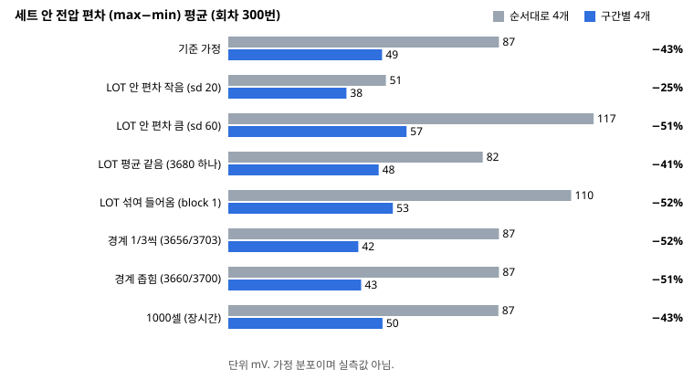

# 세트 편차 비교 시뮬레이션 (11/27)

계획서 핵심 지표는 "순서대로 4개씩 묶은 세트보다 세트 안 전압 편차 50% 이상 감소"다. 이걸 PLC·Factory I/O 없이 미리 확인해 본 것.
**셀 전압은 실측값이 아니라 가정한 분포**에서 뽑았다. 실측값이 나오면 `sim.py`의 `Scenario`만 바꿔서 다시 돌리면 된다.

```powershell
python docs/analysis/kit-deviation/sim.py          # 표 출력 + results-table.md, figure.svg 다시 생성
python -m unittest docs/analysis/kit-deviation/test_sim.py
```

## 방법

[design-notes.md](../../design-notes.md) "편차 비교 방법" 그대로.

- 세트 편차 = 세트 안 최대 전압 − 최소 전압 (mV)
- 감소율 = (순서 평균 편차 − 구간 평균 편차) ÷ 순서 평균 편차
- 두 방식에 같은 합격 셀, 같은 투입 순서를 쓴다. 회차 300번 돌려 평균과 5~95% 범위를 낸다.
- 합격 기준·경계값은 [interface.md](../../interface.md) D2200~ 초기값(3500~3800 mV, A ≥ 3750, B ≥ 3650).

기준 가정: 100셀, LOT 3개(평균 3640/3680/3720 mV)가 10개씩 번갈아 투입, LOT 안 표준편차 40 mV, 규격 이탈 5%.

## 결과



| 시나리오 | 순서 평균 편차 | 구간 평균 편차 | 감소율 (5~95%) | 세트 수 순서/구간 | 남은 셀 | 대기 평균/최대 |
|---|---:|---:|---:|---:|---:|---:|
| 기준 가정 | 87 mV | 49 mV | **43%** (33~52) | 23.3 / 22.5 | 4.5 | 4.1 / 37 |
| LOT 안 편차 작음 (sd 20) | 51 mV | 38 mV | **25%** (12~37) | 23.4 / 22.6 | 4.5 | 3.3 / 27 |
| LOT 안 편차 큼 (sd 60) | 117 mV | 57 mV | **51%** (43~60) | 22.5 / 21.7 | 4.6 | 4.5 / 34 |
| LOT 평균 같음 (3680 하나) | 82 mV | 48 mV | **41%** (31~51) | 23.4 / 22.6 | 4.7 | 3.7 / 37 |
| LOT 섞여 들어옴 (block 1) | 110 mV | 53 mV | **52%** (45~60) | 23.2 / 22.4 | 4.6 | 4.3 / 41 |
| 경계 1/3씩 (3656/3703) | 87 mV | 42 mV | **52%** (44~59) | 23.3 / 22.5 | 4.5 | 4.5 / 22 |
| 경계 좁힘 (3660/3700) | 87 mV | 43 mV | **51%** (42~58) | 23.3 / 22.5 | 4.6 | 4.6 / 23 |
| 1000셀 (장시간) | 87 mV | 50 mV | **43%** (40~46) | 235.4 / 234.6 | 4.5 | 4.7 / 84 |

대기는 셀이 레인에 들어와서 세트로 나갈 때까지 지나간 투입 셀 수. 남은 셀은 회차가 끝났을 때 4개를 못 채우고 레인에 남은 합격 셀.

## 읽은 것

1. **구간별로 모으면 편차는 확실히 준다.** 모든 시나리오에서 줄었다. 세트 수는 회차당 1개 안팎 적다(끝에 레인 3곳에 남는 셀 때문).
2. **지금 경계값(3650/3750)으로는 50%를 못 넘는다.** 기준 가정에서 43%. A는 3750~3800(50 mV)인데 C는 3500~3650(150 mV)으로 너무 넓다. 셀 대부분이 B·C에 몰린다.
3. **경계를 셀 분포에 맞추면 50%를 넘는다.** 합격 셀이 A/B/C에 1/3씩 가도록 잡으면 52%. 최대 대기도 37 → 22로 준다(레인이 고르게 차니까).
4. **셀이 원래 고르면 50%는 무리다.** LOT 안 편차가 20 mV면 순서대로 묶어도 51 mV라 줄일 여지가 적다(25%). 이때는 "감소율"보다 "세트 편차 몇 mV 이하"처럼 절댓값 목표가 맞다.
5. **100셀 한 번은 운이 크다.** 같은 가정에서도 33~52%로 흔들린다. 시연 한 번의 숫자로 합격·불합격을 말하기 어렵다. 같은 데이터를 시뮬로 여러 번 돌린 값을 같이 보여 주는 게 낫다.

## 그래서 제안

- 경계값은 **실측 셀 분포를 보고 1/3씩 나뉘게** 정한다. 래더에 상수로 안 박았으니(D2203/D2204) SCADA에서 바꾸면 된다.
- 목표 문구를 "감소율 50%(잠정)" 하나에서 **"감소율 + 세트 편차 절댓값"** 두 개로 바꾸는 걸 검토한다. 실측 sd를 보고 정한다.
- 실측이 안 되면 발표에서는 이 시뮬 결과를 "가정 분포 기준"이라고 밝히고 쓴다.

## 한계

- 전압만 본다. 내부저항은 넣지 않았다(design-notes: IR 못 재면 전압 편차 비교로 한정).
- 재검·측정 실패·LOT 보류는 빠졌다. 보류가 생기면 해당 LOT 셀이 빠지니 세트 수는 더 줄어든다.
- 레인 용량 4는 세트 배출과 동시에 비므로 막힘이 생기지 않는다. 2B 미준비로 배출이 막히는 경우는 [비정상 시험](../../abnormal-cases.md)에서 다룬다.
