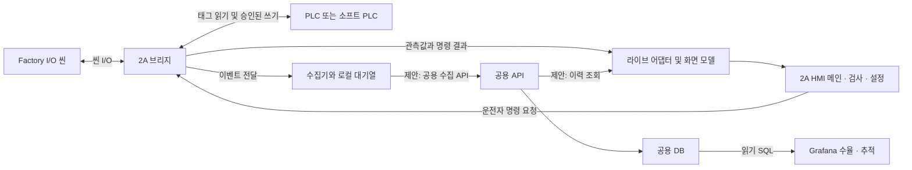
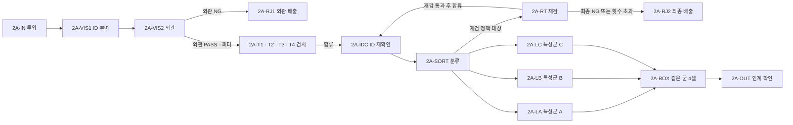

# Cellect 2A 전용 HMI v0.2 설계

**설계 초안 · 2026-11-24.** 범위는 2-A 운전자 화면, 연결 계약과 검증 기준이다. 화면과 명령은 설계 단계이며, 현재 개발 기준은 문서에 기록된 소프트 PLC 시연과 별도 Grafana 조회다.

| 문서 | 내용 |
| --- | --- |
| [화면 설계](screens.md) | 메인 운전, 검사·분류, 설정·알람의 와이어프레임과 기능 |
| [화면 데이터·제어 계약](interfaces.md) | 출처·단위·갱신, 상태 모델, 명령 수명주기, 인터록과 예외 |
| [PLC 태그 매핑표](plc-tag-map.md) | `line_v0`에서 확인한 매핑, v2 초안, 미확정 주소의 구분 |
| [확장·검증 및 협의 목록](rollout.md) | 단계별 진입 기준, 변경 영향, 테스트, 담당자 미결 항목 |

## 전체 구조

PLC 쓰기를 수행하는 소프트웨어는 **브리지 하나**다. HMI는 브리지에 조작을 요청하고, 조작 결과는 PLC의 확인 신호 또는 합의된 결과 상태를 브리지가 읽어 알린다. 운전 조작과 DB 이력은 독립된 경로다. 공용 API를 통한 수집·이력 조회와 라인별 HMI 방향은 팀 제안이며, 채택 상태와 인터페이스 버전은 담당자 합의를 따른다. Grafana는 기존 모니터링과 장기 추적에 사용한다.

## 공정도와 역할

공정 v2의 목표 흐름이다. IDC 불일치·미판독과 재검 후보의 실제 경로·정지 조건은 PLC 담당자와 확인한다. A/B/C는 합격 셀을 나누는 전기적 특성군이다. 현재 설계 메모는 합격 판정 후 OCV 구간을 사용하고, IR은 유효한 경우 판정에 반영한다. 화면에는 품질 순위나 수명·용량 등급을 부여하지 않는다.

## 현재 확인 범위

| 구분 | 근거와 한계 |
| --- | --- |
| `line_v0` PoC | [실행 문서](../run-line.md)에 씬 로드, Modbus, 센서 입출력과 NG/A/B/C 분류가 확인돼 있다. 조작반 Start/Stop/Reset은 시연용 입력이다. OCV·IR은 래더 임시 표에서 오고, 4셀 공급의 최종 통합 검증은 남아 있다. |
| 로컬 PoC 관측 | 소프트 PLC의 `8765` 읽기 전용 JSON 코드에 `connected`, `simulation_running`, 센서, 출력, 메모리, 이벤트가 있다. `simulation_running`은 씬 실행 상태이고 `M2300` 운전 자기유지와 구분한다. 이 설계에서 실행 서버에 접속하지 않았다. |
| v2 시나리오 | 네 개 검사기, 두 단계 비전, IDC, RT, 레인별 출입, 4셀 완료 및 상대 라인 인계는 목표 구성이다. PoC의 단일 검사 위치 값을 여러 v2 검사기에 복제할 수 없다. |
| DB·Grafana | 기존 [SCADA 운영 검증](../scada/db-integration/integration-test.md)은 읽기 쿼리 검증이다. 회차에 데이터가 존재하더라도 수집기가 실제 공정에서 작성했다는 근거가 없는 경우 출처를 `미확인`으로 표시한다. HMI용 이력 어댑터와 제어 브리지는 설계 단계다. |

검토 문서. [2A 공정·데이터 설계](../2a-data-design.md) · [PLC 인터페이스](../interface.md) · [판정·보류·인계 규칙](../design-notes.md) · [시연 실행·제약](../run-line.md) · [팀 공용 DB·API·SCADA/HMI 아키텍처 제안서](https://github.com/intel7-team2/battery-db/blob/52b18d3880341d18b757dd42608130991328807d/docs/architecture-proposal.md).
