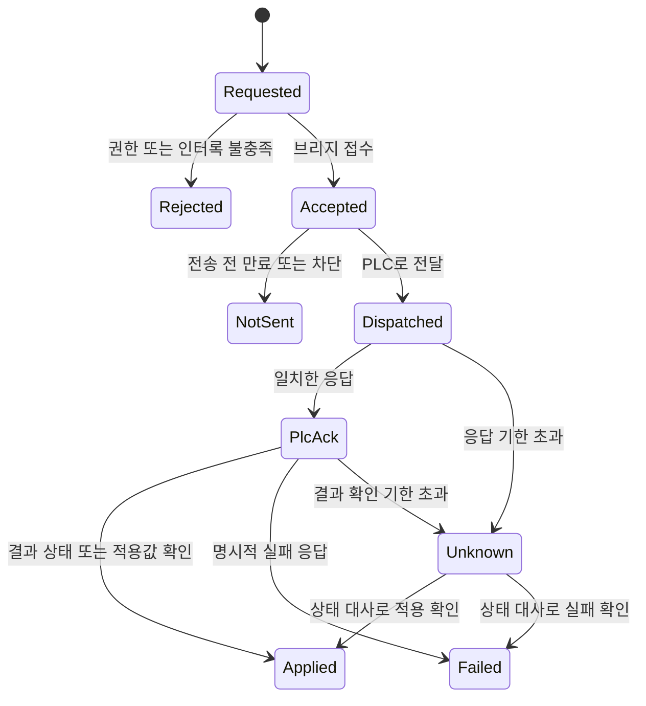

# 화면 데이터와 제어 인터페이스 초안

## 경로와 데이터 계약

화면은 논리 필드를 읽는다. `line_v0` 관측 어댑터와 향후 v2 브리지 어댑터는 [별도 주소표](plc-tag-map.md)를 사용한다. 이력 어댑터의 도입 경로는 공용 조회 API를 제안한다. 해당 API가 없으면 이력 영역을 `미연동`으로 표시하고 Grafana에 연결할 수 있다. 공정 실시간 값은 브리지 관측을, 장기 분석과 과거 이력은 DB 기반 결과를 사용한다. 서로 다른 시각·회차·출처의 값을 하나의 현재 상태로 합치지 않는다.

| 화면 모델 | 논리 필드와 타입 | 규칙 |
| --- | --- | --- |
| `LineSnapshot` | `line_id='2A'`, `profile`, `run_id`(선택), `bridge_session_id`, `snapshot_revision`, `observed_at`, `received_at`, `links[]`, `stations[]`, `capabilities[]` | 한 개의 일관된 관측 묶음. 회차 미확인은 `null`. 프로필에는 모의·실물·출처 미확인 구분을 둔다. |
| `Point<T>` | `value`(선택), `source_kind`, `observed_at`(선택), `freshness`, `reason` | `source_kind`는 `SIM`, `BRIDGE_PLC`, `HISTORY_API` 등 어댑터가 명시. 수집되지 않은 값은 `null`. 브리지 수집 시각은 장비 발생 시각이 없는 경우 별도 표시한다. |
| `StationState` | `station_id`, `state`, `state_since`, `quality`, `active_alarm_ids[]`, `selected_entity` | 스테이션 코드는 2A 논리 식별자. 값이 없는 알람 목록은 미수집으로 표시하고, 확인된 빈 목록만 0건으로 표시한다. |
| `InspectionAttempt` | `run_id`, `cell_id`, `inspection_id`, `station_id`, `attempt`, `started_at`, `measured_at`, `ocv_mv`, `ir_mohm`, `result`, `reason`, `criteria_revision` | 측정값은 정수 원값을 유지. ID가 미정인 관측은 추적 미확정 표시. 1차·재검·최종 확정은 따로 보이며, 최근 행을 최종 확정으로 간주하려면 상태·규칙이 필요하다. |
| `SortRecord`·`KitRecord` | `planned_group`, `observed_lane`, `sort_confirmed_at`, `kit_id`, `slots[]`, `composition_state`, `handoff_request_id`, `handoff_state` | A/B/C는 합격 셀의 전기적 특성군. 실제 진입이나 4슬롯 미확정은 완료 집계에 포함하지 않는다. |
| `AlarmRecord`·`LotHold` | `alarm_id`, `code`, `severity`, `raised_at`, `acknowledged_at`, `cleared_at`, `lot_code`, `hold_state`, `reason`, `revision` | 발생·확인·해제를 구분. 이전 회차 또는 이력 지연을 라이브 인터록 해제로 해석하지 않는다. |

업데이트는 라이브 스냅샷, 확정 이벤트, 주문형 이력 세 가지다. 라이브는 검증된 브리지 발행 주기를 따르고 화면은 배치 갱신한다. 설계 초기에는 가상 시험에서 UX 갱신을 0.25~0.5초로 평가할 수 있으며, 실제 주기·유효 시간은 태그량·스캔·네트워크 시험 후 승인한다. 이벤트는 스냅샷과 함께 받은 순서 키를 이용해 표시한다. 이력은 ID 검색·회차 전환·새로고침 시 조회하고, 연결 복구 시 현재 스냅샷을 다시 요청한다. 태그나 연결 종류별 유효 시간을 따로 둔다.

### 표시 데이터 사전

| 화면·대상 | 표시 데이터 | 원천 후보와 현재 범위 | 단위·변환 | 갱신 방식 |
| --- | --- | --- | --- | --- |
| 공통 라인·연결 | 모드/회차, 씬 실행·일시정지, PLC 운전 허용·운전, 연결·마지막 정상 관측 | PoC JSON의 통신·씬 상태와 래더 운전 비트. 모드·제어권·회차 연결은 v2 브리지 계약 필요. API 도달 여부는 이력 채널에 따로 표시. | 상태 코드, ID, 시간 | 브리지 스냅샷과 연결 감시 |
| `2A-IN` | 투입 시각, 투입 순번, 선택 회차 투입 수 | PoC 입고 센서. v2 `CREATED` 및 회차별 이벤트 집계, ID 미읽기는 별도 | UTC 시각, 순번, 셀 수 | 현재 센서 스냅샷, 확정 이벤트 집계 |
| `2A-VIS1` | Cell ID, LOT, 판독·대기 결과 | v2 Vision·브리지 `ID_READ`. PoC `D2000`은 LOT 입력 | 문자열·코드 | 판독 확정 이벤트 |
| `2A-VIS2`·`2A-RJ1` | 외관 PASS·NG·대기, 결함 사유·외관 배출 | v2 `APPEARANCE` 및 `SCRAPPED` 배출 확인. PoC의 NG 경로만으로 외관 불량 판정 불가 | 상태·코드, 셀 수 | 단계 이벤트 |
| `2A-T1`~`2A-T4` | 레인별 상태·Cell ID·시도·OCV·IR·결과·측정 시각 | v2 검사기 브리지와 `TEST_START/END`; 검사 이력은 확인된 조회 계약. PoC 임시 측정값은 시뮬레이션 출처 | OCV 원값 mV, 화면 V = mV ÷ 1,000. IR mΩ. 검사 소요 초 | 상태 스냅샷, 시도별 확정 이벤트, 조회 시 이력 |
| 검사 진단 상세 | 선택 시도 V1/V2, I1/I2, 원값, 측정 유효성 | v2 측정 블록의 시도 연계 필요 | V1/V2 mV, I1/I2 mA, 필요 시 V로 환산 | 선택 검사 조회 또는 확정 이벤트 |
| `2A-IDC` | 예상·읽은 ID, 일치/불일치/미판독 | v2 `ID_CHECK`. 방식·태그 TBD | 문자열·상태 코드 | 실제 재확인 이벤트 |
| `2A-RT`·`2A-RJ2` | 재검 대상·대기·시도·사유·한도·최종 결과·배출 확인 | RT `TEST_START/END`, 룰과 `SCRAPPED`. 재검 횟수·경로 승인은 미정 | 건/회, V, mΩ, 상태 | 상태·확정 이벤트 |
| `2A-SORT`, `2A-LA/LB/LC` | 목표 특성군·실제 진입·레인 점유·대기 | 브리지 `SORTED`와 승인된 점유 관측원. PoC 카운터는 장비 실시간 점유와 별도 | 그룹 A/B/C, 레인 코드, 셀 수 | 실제 출입 이벤트 또는 유효한 레인 스냅샷 |
| `2A-BOX` | Kit/박스 ID, 슬롯 1~4, 그룹, 구성 확인·완료·편차 | `PACKED`와 `BOX_CLOSED`, 이력에서 구성 대조 | 슬롯 정수, 편차 mV = 최대 OCV − 최소 OCV. 유효한 4개 계측이 없는 편차는 미수집 | 슬롯/완료 확정 이벤트 |
| `2A-OUT` | 인계 요청 ID, Kit ID, 기대·실제 수량, 출구·수신 확인 시각 | 상대 라인 상태와 브리지 `HANDOFF`, 이력 조회. 수신 확인 정책·태그 TBD | 셀/Kit 수량 구분, ID·시각·상태 코드 | 요청·배출·확인·예외 이벤트 |
| 설정 | OCV 하/상한, IR 상한, A/B·B/C 경계, LOT NG 한도, 재검 한도, 적용 버전, 적용자·시각 | 현재값은 권한 있는 PLC 읽기 확인. 이력은 `criteria_set` 후보. PoC 초기값은 문서 참조용 | mV, mΩ, 건, 회, 버전·시각 | 설정 변경 시 읽기 확인, 화면 진입 시 조회 |
| 알람·LOT | 알람 코드·심각도·셀/스테이션·발생/확인/해제, 보류 대상·사유·해제자 | 브리지 발생·해제 관측과 이력 API. PoC LOT 신호는 래더 임시 정책 | 상태 코드, 건, ID·시각 | 발생·대사·확인 상태 변화 |

공정 발생·브리지 수신·DB 기록 시각을 가능한 경우 구분한다. 저장과 인터페이스의 시각은 오프셋을 포함한 UTC, 운영 화면은 `Asia/Seoul` 표시를 제안한다. PoC `HH:MM:SS` 이벤트 문자열에는 날짜나 UTC 오프셋을 추정해 덧붙이지 않는다. 검사 집계는 `run_id`와 `inspection_id`·`attempt`를 사용하고, 이전 회차의 레인/알람 상태를 새 회차로 복사하지 않는다.

## 접속, 값 품질, 설비 상태

| 층 | 상태 | 화면 규칙 |
| --- | --- | --- |
| 연결 | `NOT_CONFIGURED` / `CONNECTING` / `ONLINE` / `OFFLINE` | 브리지, 브리지에서 본 PLC 링크, 이력 API 채널을 각각 표시. 미연동/확인 중과 감시 중 실제 단절을 분리한다. |
| 값 품질 | `GOOD` / `MISSING` / `STALE` / `INVALID` | 관측 없음은 미수집, 시간 기준 초과는 지연, 파싱·스케일 오류는 데이터 이상. 마지막 값은 시각과 함께 회색으로 표시할 수 있다. 표시 지연과 설비 고장은 별개다. |
| 설비 | `IDLE` / `BUSY` / `BLOCKED` / `STARVED` / `FAULT` / `STOPPED` / `UNKNOWN` | 정상 대기 `IDLE`은 유효한 보고를 받은 경우에만. `BLOCKED`/`STARVED`는 후단 대기/공급 대기, `FAULT`는 명시 장애. 링크 단절 시 현재 설비 상태는 확인 불가이며 마지막 설비 상태는 별도 표기. |
| 기능 | `준비` / `미연동` / `사용 가능` | 환경별 연동·검증 상태. 준비에는 `설계` 또는 `가짜 입력 검증`을 명시. 운전자가 실제로 누를 수 있는지는 별도의 인터록 결과 및 권한으로 평가. |

예를 들어 설비가 마지막에 `IDLE`을 보고한 뒤 PLC 링크가 끊기면 `PLC 통신 단절 · 마지막 정상 대기 HH:MM:SS`로 표시한다. DB가 끊기고 PLC가 응답하면 라이브 운전 영역의 검증된 권한과 안전 상태를 유지하고, 이력 영역만 지연 또는 조회 불가로 표시한다. 회차 변경·브리지 재시작 뒤에는 새 세션 스냅샷으로 상태를 다시 확인한다.

## 브리지 명령 계약

아래는 **논리 계약 제안**이다. 전송 방식, URI, PLC 수신 주소, PLC 시퀀스 비트·타이머는 미정이다. HMI는 `관측 읽기`, `명령 제출`, `명령 ID로 결과 조회` 동작을 사용한다. 명령은 브리지로 보내고 결과 기록을 같은 명령 ID로 조회한다.

| 메시지 | 필드와 규칙 |
| --- | --- |
| 요청 | `command_id`(고유, 전송 재시도 때 유지), `line_id`, `action`, `target`, 타입이 정해진 `arguments`, `expected_session`·`expected_revision`·필요 시 `expected_run_id`, `reason`. 운전자·권한은 브리지 인증 세션에서 확인한다. |
| 접수 | `command_id`, 검증 결과, 표준 사유, `accepted_at`, 브리지 기준 만료 시각. 접수 성공은 PLC 적용 여부를 뜻하지 않는다. |
| 진행·완료 | `command_id`, 상태, PLC 상관키/순번(협의), `sent_at`, `ack_at`, `completed_at`, `reason_code`, 검증된 `snapshot_revision` 또는 적용값 읽기 결과. |
| 저장·감사 | 브리지는 동일 ID·동일 내용이면 기존 결과를 반환하고, 내용이 다르면 충돌로 거절한다. 세션 재시작 뒤에도 전송 여부를 확인할 수 있도록 ID·대상·결과의 로컬 기록 범위를 정한다. 수집 이벤트 중복키는 별도 계약이다. |

브리지는 접수 시와 쓰기 직전에 권한·제어권·실제 인터록을 평가한다. 이미 보낸 명령의 결과가 불확실하면 같은 ID로 결과 조회만 하고, 자동 재실행하지 않는다. 재시작·통신 복구 후에는 PLC 상태·미결 명령 대사를 마친 뒤 새 조작을 허용한다. 접수·응답·효과 확인의 타임아웃을 따로 측정하고 값을 미리 확정하지 않는다. 전송하지 않은 경우만 `미전송`, 응답을 잃은 경우는 `결과 미확정`으로 표시한다. 상관키를 PLC가 지원하기 전에는 물리 작동의 정확히 한 번 실행을 보증하지 않는다. 시작·리셋·설정 같은 상호 충돌 명령은 한 경로에서 직렬화한다. 정지는 우선 처리 경로와 결과 확인 방식을 PLC 담당자가 승인한 뒤 사용한다.

| 논리 액션 | 인터록·권한 제안 | 적용 확인과 예외 |
| --- | --- | --- |
| `START` | 확인된 운전자 제어권과 모드, PLC 링크, 명시된 운전 허용, 미해소 안전·설비 장애 없음, 미결 시작·리셋 없음. 상세 PLC 인터록은 담당자 승인. | 운전 상태가 바뀌었는지 읽기 확인. 이미 운전 중이면 중복 구동 없이 현재 상태 반환. 복구·리셋 직후 자동 시작 금지. |
| `STOP` | 확인된 제어 경로를 통해 요청. 이력 채널 장애, 오래된 HMI 조회 버전이나 시작 요청 처리 중이라는 이유로 정지를 차단하지 않도록 별도 우선 처리 검증. | 브리지가 읽은 정지 결과로 확인. 경로·응답이 끊겼으면 현장 정지 장치를 안내하고 화면에서 정지를 확정하지 않는다. 물리 비상정지 제어는 별도 안전 회로의 책임. |
| `RESET_FAULT` | 정지와 안전·장애 원인 해제 조건을 확인하고 운전자가 대상·영향을 확인. 미결 Kit 대사는 별도 처리. | 대상 장애 상태를 재조회한다. LOT 보류와 요청·인계 이력·사용자 감사 기록을 유지한다. 현재 PoC `M2017` 동작은 이 계약과 호환되지 않는다. |
| `APPLY_CRITERIA` | 승인된 권한과 사유, 적용 중인 버전 대조, 값 범위·단위·경계 순서 및 적용 허용 시점 확인. | 전체 적용값을 읽어 일치 확인한 뒤 새 버전 표시. 부분 적용은 완료로 처리하지 않는다. 동시 검사와 변경의 적용 시점은 PLC와 합의. 이력 저장 지연은 PLC 적용 결과와 별도 표시. |
| `ACK_ALARM` | 현재 알람 ID와 유효한 작업자 권한. 해제와 확인을 구분. | 기존 확인을 재반환할 수 있다. 설비 장애 해제나 재시작을 유발하지 않는다. PLC·브리지 책임 분담은 미정. |
| `RELEASE_LOT_HOLD` | 권한·사유·LOT 버전, 진행 중/인계된 셀 조치, 생산 라인과 상대 라인 상태 대사 필요. | 실제 허용 복귀와 이력 동기화 결정을 구분. 상태의 권위 원천과 장애 시 정책 합의 전까지 비활성화. |
| `RECONCILE_HANDOFF` | 요청 접수·출구 감지·수량·수신 측 기록을 정확한 요청 ID로 대조. 처리 권한과 상대 라인의 승인 규칙 TBD. | 인계 상태 조회 또는 승인된 확인 요청만. 재시도·시간 초과로 물리 배출을 반복하지 않는다. |

## 예외 처리

- **LOT 보류**는 적용 대상 LOT, 보류 사유, 확정 NG 누계의 출처, 공급 차단 상태를 표시한다. 측정 실패·판독 대기는 확정 NG 누계에서 분리한다. 보류 재고는 잠금 상태, 이미 진행·인계된 셀은 상대 라인 통보 대상으로 표시한다. 별도 검토·승인 뒤 해제한다.
- **재검**은 시도와 검사 ID를 기록한다. 미측정 IR은 결측을 유지하고, 미측정의 판정 처리는 승인 정책을 따르게 한다. 재검 대기와 한도 초과/최종 배출을 구분한다. IDC 오류로 셀과 시도 연결을 확정할 수 없으면 자동 진입 성공으로 표시하지 않는다.
- **Kit 인계**는 `요청 → 구성·준비 → 출구 감지 → 수신 확인`을 표시하며 각 단계의 권위 원천을 함께 기록한다. 수량 불일치나 확인 기한 초과는 상태 대사로 전환한다. DB/API 기록 실패 시 브리지 로컬 기록과 동일 이벤트 ID 재전송을 제안한다. 로컬 기록도 실패한 경우 새 공급 차단은 설계 메모의 정책을 따른다. 복구 후 요청·완료 ID 및 물리 수량을 대조하기 전 자동 공급 재개를 막는다.
