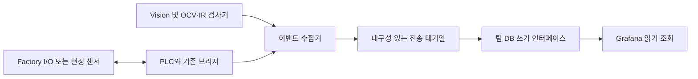

# Factory I/O·PLC 이벤트 수집 인터페이스

2026-11-23 협의 초안. [공정 v2 데이터 수집점](../../2a-data-design.md#2-데이터-수집점), [PLC 인터페이스](../../interface.md), [현재 시연 구성](../../run-line.md)을 기준으로 한다. 현 시연은 Factory I/O가 로컬 Modbus 서버에 연결되고 `8765`의 JSON은 상태 확인에 쓰인다. 실제 공정 이벤트의 출처, 장비 연결 방식과 레지스터 계약은 PLC·Vision·검사 담당자와 확정한다.



제어와 수집의 연결점은 기존 브리지다. 수집기와 Grafana는 별도 DB 권한을 사용한다. 메일박스 읽음 확인을 PLC에 기록해야 한다면 기존 PLC 쓰기 담당 브리지가 수행한다.

## 논리 이벤트 봉투

아래는 브리지에서 정규화해 팀 DB 쓰기 인터페이스로 전달할 필드다. 각 팀이 실제 전송 형식과 DB 저장 위치를 합의한다.

| 필드 | 타입·규칙 |
| --- | --- |
| `contract_version` | 문자열 또는 정수 버전. 수집기가 해석 가능한 페이로드 규격 표시 |
| `event_key` | 문자열 또는 UUID. 재전송에도 동일한 이벤트의 식별자는 유지 |
| `run_id`, `source_id`, `source_session_id` | 문자열. 실행, 생산자·메일박스, 부팅·순번 재시작 구간 식별 |
| `source_sequence` | 정수. 한 생산자 세션 내 단조 증가 순서. 랩어라운드 정규화와 재부팅 경계를 협의 |
| `kind`, `station_code`, `data_origin` | 문자열 코드. 이벤트 종류, 설비 위치, 시뮬레이션·현장·시험 출처 |
| `occurred_at`, `received_at` | 시간대 포함 시각. 각각 공정 발생 시각과 수집기 수신 시각. DB 기록 시각은 조회 시 별도로 구분 |
| `timestamp_source` | 시간 출처 구분. 장비 시계가 없으면 브리지 관측 시각과 그 한계를 표시 |
| `cell_id`, `input_ref`, `inspection_id`, `kit_id` | 이벤트별 관련 식별자. ID 미판독은 임시 투입 키 `input_ref`로 연결 |
| `payload` | 이벤트별 값. 시작·완료, 결과, 원값, 사유, 레인·슬롯 등 |

## 수집 이벤트와 데이터 원천

| 공정 | 공정 v2 이벤트 후보 | 수집 필드·원천 |
| --- | --- | --- |
| 투입·ID | `CREATED`, `ID_READ` | 투입 순번·임시 키, LOT, Vision이 발급·판독한 Cell ID 및 성공·실패. ID는 병렬 레인 합류 후에도 검증 가능한 키로 전달 |
| 외관 | `APPEARANCE`, `SCRAPPED` | Vision 원본 G/NG 등 코드, 정규화한 PASS/FAIL, 결함·배출 사유. 실제 배출은 PLC 확인 이벤트로 구분 |
| 전기검사·재검 | `TEST_START`, `TEST_END` | 검사 ID, Cell ID, 시도 번호, 2A-T1~T4/2A-RT, 시작·완료, OCV·IR 원값과 단위·스케일, 검사 결과 및 기준 버전. 측정기·브리지 값은 검사 ID로 PLC 이벤트와 연결 |
| 특성군·Buffer | `ID_CHECK`, `SORTED`, 버퍼 관측 후보 | 목표와 실제 레인, ID 일치, 실제 진입, A/B/C 그룹. 이동·반출·폐기 및 재고 기준점은 방식 합의 후 전송 |
| 포장·인계 | `PACKED`, `BOX_CLOSED`, `HANDOFF` | Kit/박스 ID, 셀 ID와 슬롯, 그룹, 실제 적재·완료·인계 시각 및 확인 상태. 슬롯 정보와 완료를 같은 Kit ID로 연결 |
| 수집 상태 | 하트비트 및 순번 누락·복구 | 마지막 수신·정상 전달 시각, 소스 세션과 순번 범위, 오버플로, 누락·지연 상태 |

검사기·Vision과 PLC의 이벤트 연결에 검사 ID나 임시 투입 키가 필요하다. 병렬 처리와 재검이 있으므로 도착 순서만으로 측정값과 Cell ID를 결합하지 않는다. 측정 원천, 값의 signed 여부·워드 순서·스케일, 0과 미계측 구분, 차단·타임아웃의 결과 코드, 최종 판정 출처를 장비 담당자와 확인한다.

## 메일박스와 재전송

1. 공정 v2에는 `D2700~D2799`의 8슬롯 링 버퍼, 쓰기·읽음 순번과 오버플로 카운터가 제안되어 있다. 주소·길이·갱신 권한, 순번 비트 폭, 슬롯 게시·유효성 표기, 최대 이벤트 빈도와 허용 ACK 지연을 PLC 담당자와 확인한다. 100ms 폴링은 검토 시작값이며, 순번과 안정적으로 게시된 레코드로 이벤트를 소비한다.
2. 브리지는 완전히 게시된 레코드만 읽고 유효성을 검사한 뒤, 내구성 있는 대기열에 넣고 읽음 순번을 올린다. 내구성 있는 대기열이 없다면 DB가 커밋된 뒤에만 ACK를 보낸다. 다중 워드 읽는 중 슬롯이 바뀌면 재조회하며, 읽지 못한 구간이나 오버플로는 출처와 순번 범위를 기록한다.
3. 수집기는 DB 커밋 전 통신 실패를 재시도한다. 커밋 여부를 모르면 같은 `event_key`로 재전송하고, DB 담당자가 승인한 중복 처리 규칙을 적용한다. 같은 키로 내용이 다르면 충돌로 분리한다. 공정 v2의 UUIDv5 `run_id`/순번 규칙은 작업 가정으로 검토하되, 여러 생산자나 재부팅·랩어라운드에서도 키가 충돌하지 않는지 먼저 확인한다.
4. 재시작 시 마지막 내구 확인 지점에서 재개한다. 선행 이벤트가 늦는 경우 재시도 또는 격리·재처리 경로를 둔다. 장기 DB 단절 시 대기열 용량·보존과 PLC 버퍼 한계를 측정하고, 누락 구간을 Grafana의 수집 상태에서 구분할 수 있게 전달한다.
5. Kit 완료 조회에 필요한 4슬롯과 완료 상태의 일관성을 제공한다. `PACKED` 여러 건이 순차 도착하면 완료 이벤트와 함께 트랜잭션으로 확정하거나, 4셀 대조까지 완료 상태 공개를 보류하는 방법을 DB 담당자와 합의한다.

승인 받을 항목은 기존 브리지 지원 프로토콜, 메일박스와 데이터 코드표, PLC·Vision·검사기 간 키 전달, 시계 동기화, 대기열·재처리 정책, 쓰기 계정과 접속 경로다. 실제 태그 주소표는 [PLC 태그맵](../../../plc/tagmap.md)을 기준으로 관리한다.

## 로컬 수집 대기열 검증

[`collector/spool.py`](../collector/spool.py)는 위 이벤트 봉투의 로컬 초안 버전 1을 JSONL로 받아 SQLite에 저장한다. 기본 파일은 Git에서 제외되는 `docs/scada/.local/collector-spool.sqlite3`이다. 이벤트 봉투 예시는 [테스트의 `sample()`](../collector/test_spool.py)에 있다.

```powershell
python -X utf8 -B .\docs\scada\collector\spool.py enqueue .\qa-events.jsonl
python -X utf8 -B .\docs\scada\collector\spool.py pending --limit 10
python -B -m unittest discover -s docs/scada/collector -v
```

`enqueue`는 파일 전체를 한 트랜잭션으로 저장한다. 같은 `event_key`와 동일한 이벤트를 재전송하면 최초 수신 시각을 유지하고 중복으로 계산한다. 내용이 달라졌거나 동일한 실행·생산자·소스 세션·순번에 다른 키가 들어오면 배치 전체가 롤백된다. `pending`은 도착 순서로 아직 전송 확인되지 않은 이벤트를 출력한다.

브리지는 로컬 커밋 이후 ACK 가능 여부를 판단해야 한다. 연속 순번의 ACK 기준과 누락 처리, 운영 DB 이벤트 ID 생성·매핑, 전송·재시도는 연동 단계에서 확정한다. `mark_delivered()`는 향후 단일 전송기가 대상 DB 커밋 확인 뒤 호출할 메서드다. 현재 CLI는 로컬 파일 입출력만 수행한다.
